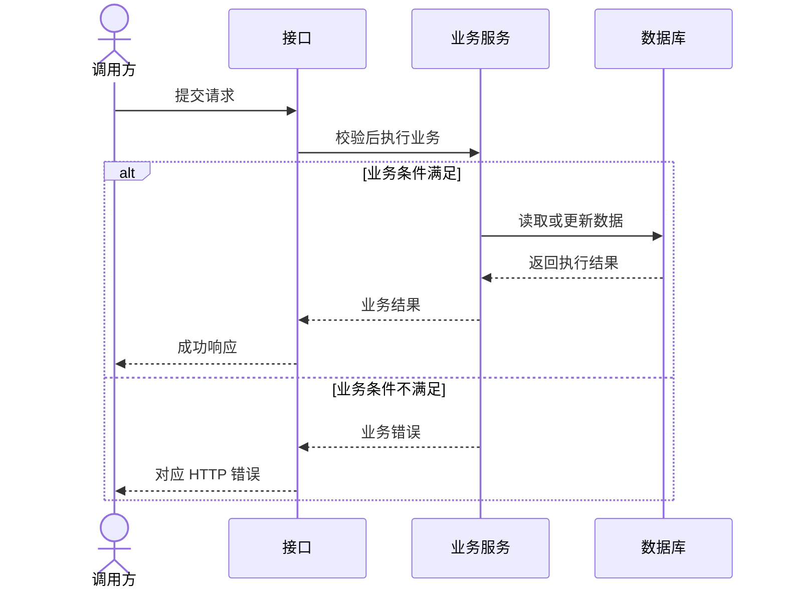
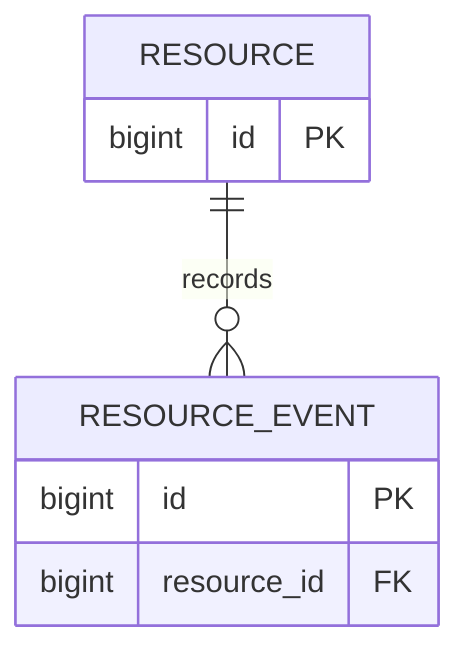

# 需求名称

- 关联：需求来源、Issue、PR、相关规格或接口契约
- 基线：相关模块和提交（如有）

## 1. 需求与验收

说明业务背景和用户目标，写清当前生效规则与本次拟改范围。每条验收标准描述可观察结果。后续替换规则时保留原编号，标明后继验收项，并在下文链接原验收证据。

| 编号 | 场景与触发条件 | 预期结果 |
|---|---|---|
| AC-1 | 填写核心场景 | 填写可验证结果 |

## 2. 现状与技术方案

引用实际代码、配置、已有表和接口。列出涉及模块、职责、关键取舍及兼容影响。

### 时序图

以下参与者为填写示例。用项目实际角色和模块替换，补充关键失败分支。

## 3. 数据库设计

### ER 图

以下实体为填写示例。用实际表名、关联和基数替换。

### 表结构与迁移

| 表 | 字段 | 类型 | 可空及默认值 | 键或约束 | 业务含义 |
|---|---|---|---|---|---|
| 填写表名 | 填写列名 | 填写数据库类型 | 填写 | 填写 | 填写 |

列出索引及其支持的查询，说明关联的实现方式。结构有变化时记录迁移版本、目标数据源、已有数据处理和恢复路径。

## 4. 接口设计

| 接口 | 方法和路径 | 请求与校验 | 成功响应 | 错误与状态码 | 验收项 |
|---|---|---|---|---|---|
| 填写名称 | 填写 | 填写 | 填写 | 填写 | AC-1 |

补充关键请求与响应示例。写明分页、排序、权限、幂等和调用方兼容要求中适用的部分。

## 5. 实施、验证与发布

实施步骤和完成记录见 [任务看板](tasks.md)。本节保留验收结果与发布方案。按需说明上线顺序、观测信号、回退条件与执行人。

| 验收项 | 验证方式与预期 | 验证环境、结果与证据 |
|---|---|---|
| AC-1 | 测试、命令或手工步骤 | 实现后填写 |

每条验收项关联任务，或在本表写明验证安排。可在本表记录手工验证步骤、历史证据及其适用范围，或注明已确认的延期原因和后续条件。交付后记录实际结果，注明仍待验证的场景及所需数据、环境或上游契约。

## 6. 待确认与决策

记录阻塞问题、推荐答案和影响。确认后保留结论及来源。

| 日期 | 决策或变更 | 来源 | 影响 |
|---|---|---|---|
| 填写 | 填写 | 对话、Issue、评审或提交 | 关联规则、接口或验收项 |
